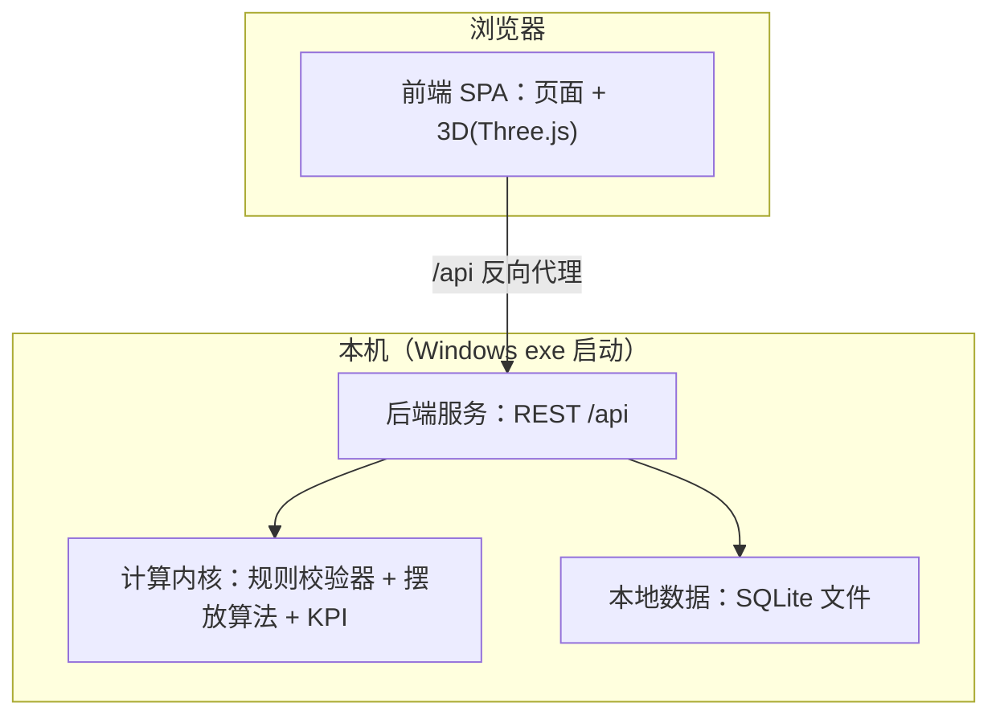

# 集装箱装箱工具 PRD（完整版 v1.2）

- 产品：集装箱装箱辅助工具（Container Packing Tool）
- 版本：v1.2（新增 R32 未匹配主数据一键补充、R33 重新计算清空；v0.3.0 语义重构已同步）
- 日期：2026-10-28
- 形态：Web 应用；Windows 上以可执行文件启动
- 需求源文件：当前工作区 `.monkeycode/specs/container-packing/requirements.md`（33 条 Requirement，EARS 格式）
- 状态：需求与计划已定稿，进入技术设计（design.md）

---

## 1. 产品概述

### 1.1 一句话定位

给装箱计划人员一套在浏览器里完成的「维护箱型/包装 → 导入业务 Excel → 补规格 → 勾 Site → 配规则 → 算方案 → 看 KPI / 3D → 回写导出」工具；Windows 现场电脑双击一个可执行文件即可启动。

### 1.2 目标用户

| 用户 | 主要操作 |
|------|----------|
| 装箱计划人员 | 建任务、导数据、勾 Site、选算法与箱模式、评估 KPI、导出 |
| 规则管理员 | 维护箱型库、包装主数据、规则开关与优先级、参数 |
| 现场装箱人员 | 按装载顺序单与 3D 回放装柜 |

### 1.3 交付物

1. Web 应用（前后端），单机运行
2. Windows 可执行启动文件：双击启动本机服务并打开默认浏览器，数据存本机
3. 本 PRD 与 requirements.md、design.md、任务清单

### 1.4 核心价值

- 按业务约束自动排柜，替代人工排柜
- 兼顾现场作业：由内向外装载、铲齿长度、人工/叉车区分
- 结果回写原表格式，现场零学习成本

---

## 2. 端到端流程

1. 维护箱型库、包装主数据（含 PN、PackMatls）
2. 创建任务，导入业务 Excel（17 列，见 §7.1）
3. 长宽高齐全的行用表内值；缺尺寸的行按 PN 优先、PackMatls 次之补全；补不齐则拦截并批量维护
4. Site 分组确认：勾选必须同柜 / 必须分离（默认全不选）
5. 配置规则开关与优先级、固定箱型或自由组合、勾选算法
6. 计算，输出各算法 KPI 对照
7. 3D 核对，指定采用方案
8. 导出：N 列覆盖为 `{箱型}-{序号}`，新增每柜从 1 重排的「装箱顺序」列

---

## 3. 功能需求汇总

Requirement 编号与 requirements.md 一一对应。

| # | 需求 | 要点 |
|---|------|------|
| R1 | 模板导入与批量上传 | 上传解析、预览、错误行标注、写入任务 |
| R2 | 按规则计算装箱方案 | 坐标+朝向+箱号；每件过全部启用规则；装不下标原因 |
| R3 | 规则配置 | 规则清单、启停、规则与数据分离、可持续新增 |
| R4 | 导出 Excel | `.xlsx`，含明细、未分配、摘要；默认模板兜底 |
| R5 | 自定义导出格式 | 模板增删改复制；字段、列序、列宽、对齐、数字格式；默认模板不可删 |
| R6 | 3D 示意 | 旋转/平移/缩放；点选高亮详情；多箱切换；按序回放 |
| R7 | 任务管理 | 任务保存输入+规则+结果；重算替换并保留上次成功方案 |
| R8 | PN 连续装箱 | 同包装类型可分柜；同 PN 先填满本柜、溢出下一柜且柜号相邻 |
| R9 | 装卸方式 | >30 kg 强制叉车；上限可配默认 30 kg |
| R10 | 轻重 | 上下堆叠下层重量 ≥ 上层；箱底视为满足 |
| R11 | 承压约束 | max_load=0 顶部禁压；可压他货；可独占一层；max_load 不为 0 时按承压上限校验 |
| R12 | 同种堆叠 | 仅同货物类型上下邻接；同层并排允许 |
| R13 | Site 同柜/隔离 | 运算前勾选；必须同柜不可拆；必须分离分箱；默认不约束 |
| R14 | 冲突优先级 | 可勾选排序；默认 Site 同柜 → PN 连续 → Site 分离 → 同种堆叠 → 承压 → 轻重 → 装卸 |
| R15 | KPI | 11 项指标（见 §6.3），任务摘要/3D 侧栏/Excel 同源 |
| R16 | 多算法 | 5 种内置；多选对照；采用方案指定；时限默认 60 秒 |
| R17 | 由内向外 | 装载序号；序号小者更靠箱内；3D 分步回放 |
| R18 | 铲齿长度 | 默认 1220 mm；叉车货进叉边长 ≤ 铲齿；人工货免检 |
| R19 | 固定箱型/自由组合 | 固定不增减；自由组合可锁箱型、锁数量、设上限；最优三级目标 |
| R20 | Web 形态 | 全功能浏览器内；3D 无插件 |
| R21 | 箱型库维护 | 13 字段；预置 20GP/40GP/40HQ；引用后禁删改停用；Excel 导入导出 |
| R22 | 包装主数据/临时包装 | PN+PackMatls 键；表值优先；临时包装可提升入库 |
| R23 | 极简留白界面 | 暖白背景、深灰文字、单强调色、四级标题、统一对齐、大留白 |
| R24 | Windows 启动 | 双击 exe 拉起服务开浏览器；端口占用自动换；数据持久 |
| R25 | 样表导入与补全 | 17 列映射；cm/kg；PN 优先补全；缺规格拦截+批量维护；N 列导入值忽略 |
| R26 | Site 确认 | 按站点列出货、默认不选、互斥校验、随任务保存 |
| R27 | 结果回写 | N 列覆盖 `{箱型}-{序号}`；新增装箱顺序列每柜重排 |
| R28 | 编码防乱码 | 全链路 `.xlsx`；CSV 兜底带 BOM UTF-8；导入识别 UTF-8/GBK；中文文件名正确 |
| R29 | 3D 多箱与回放 | 每箱独立视图；选中居中工作区；0.5/1/2/4 倍速回放 + 步进 |
| R30 | KPI 双层 | 单箱 + 整体两级；整体口径公式化、可由单箱复算 |
| R31 | 计算进度与 ETA | >3 秒显示进度与预计剩余时间；多算法分别显示；超时明示 |
| R32 | 未匹配主数据一键补充 | 导入预览页勾选未匹配键、批量填写规格、一键写入主数据并自动重新匹配，供以后任务复用 |
| R33 | 重新计算与清空 | 有历史方案时按钮显示「重新计算」，点击先清空当前任务全部 runs 再重算；无方案时显示「开始计算」仅重算 |

---

## 4. 数据模型

### 4.1 箱型库 ContainerType

| 字段 | 类型 | 说明 |
|------|------|------|
| code | string, unique | 箱型代码，如 40GP |
| name | string | 名称 |
| iso_code | string | ISO 代码 |
| inner_length / inner_width / inner_height | int mm | 内部尺寸 |
| door_width / door_height | int mm | 箱门尺寸 |
| max_payload | int kg | 最大载重 |
| tare_weight | int kg | 箱自重 |
| inner_volume | float m³ | 内部容积（自动算，可覆盖） |
| enabled | bool | 启用状态 |
| remark | string | 备注 |

预置：20GP（5898×2352×2393，28200 kg）、40GP（12032×2352×2393，26700 kg）、40HQ（12032×2352×2698，26700 kg）。尺寸以开发时核对 ISO 值为准，允许管理员编辑。

### 4.2 包装主数据 PackageMaster

| 字段 | 说明 |
|------|------|
| pn | 包装物料号，填了则唯一；查找优先键 |
| code | 包装代码 |
| name | 名称，即 PackMatls；次级查找键 |
| package_type / cargo_type | 包装类型 / 货物类型 |
| length / width / height | 长宽高，cm |
| tare / net / gross_weight | 箱重/净重/毛重，kg |
| volume | 体积，m³（可自动算） |
| rotatable | 是否四面进铲（允许叉车从任一侧水平进叉） |
| same_type_stack | 是否仅同种堆叠 |
| default_loading_method | 默认装卸方式 |
| max_stack_layers | 最大堆码层数（仅 same_type_stack 勾选时生效） |
| max_load | 最大承压（kg）；0 = 不可被压，NULL = 不设上限 |
| enabled / remark | 启用状态 / 备注 |

### 4.3 任务 Task 与装箱方案 PackingPlan

- Task：名称、创建时间、导入行集、参数（人工上限、铲齿长度、时限、间隙）、规则启用集与优先级、Site 勾选、箱模式配置、当前采用方案、上一次成功方案
- ImportRow：对应 §7.1 的 17 列 + 补全标记（哪些字段来自主数据）+ 来源（表内/主数据/临时包装）
- PackingPlan：每件货物 → 集装箱实例、坐标（长/宽/高方向 mm）、旋转朝向、装载序号、未分配原因；集装箱实例 → 箱型、序号（用于 40GP-1 命名）、KPI

### 4.4 全局参数

| 参数 | 默认值 | 可调 |
|------|--------|------|
| 人工装箱重量上限 | 30 kg | 是 |
| 铲齿长度 | 1220 mm | 是 |
| 算法计算时限 | 60 秒 | 是 |
| 货物间隙 | 0 mm | 是 |

---

## 5. 业务规则明细（计算引擎执行用）

执行顺序：预检 → 箱模式约束 → Site 同柜/隔离 → PN 连续 → 摆放（DBLF 等算法 + 碰撞/轻重/承压/同种堆叠逐件校验）→ 装卸方式与铲齿 → KPI。

### 5.1 分配类规则

| 规则 | 语义 | 失败处理 |
|------|------|----------|
| Site 必须同柜 | 勾选的多个 Site 全部货物进同一个箱，不可拆 | 整组未分配：同柜组无法整组入箱 |
| Site 必须分离 | 勾选的 Site 互不同箱 | 冲突件重选箱；无箱则未分配 |
| PN 连续 | 同 PN 先填满本柜，溢出接续下一柜，柜号相邻；同 PN 同箱内沿箱长连续 | 仅溢出装不下的单件未分配 |
| 固定箱型 | 只用指定箱型与数量 | 装不下的标「固定箱量不足」 |
| 自由组合 | 锁箱型/锁数量/上限；目标：完成率 → 用箱数 → 平均体积利用率 | 锁定无解则终止提示 |

### 5.2 摆放类规则

| 规则 | 语义 |
|------|------|
| 轻重 | 上下堆叠：下层单件重 ≥ 上层；箱底免检 |
| 承压 | 支撑件 max_load=0 时禁止顶部堆压；max_load 不为 0 时按承压上限校验；被压件可独占一层 |
| 同种堆叠 | 标记件上下邻接必须同货物类型；同层并排允许 |
| 由内向外 | 装载序号 1 最靠箱内深处；同箱两件：序号小者内端面更近或等距箱内 |
| 铲齿 | 叉车货进叉方向边长 ≤ 1220 mm（可配）；不可则试另一水平边；再超则未分配；人工货免检 |
| 装卸方式 | >30 kg 自动叉车；≤30 kg 按指定 |
| 旋转 | 默认允许水平 90°（rotatable「四面进铲」控制单件开关，叉车可从任一侧进叉）；垂直翻转禁止 |

### 5.3 冲突与降级

- 优先级默认：Site 必须同柜 → PN 连续 → Site 必须分离 → 同种堆叠 → 承压 → 轻重 → 装卸方式；用户可改
- 冲突时遵守高优先级，结果记录被降级规则名，进入「约束满足率」分子分母

---

## 6. 计算引擎规格

### 6.1 算法

| 算法 | 首版角色 |
|------|----------|
| DBLF（深底左填充） | 默认启用 |
| 最大空腔（Empty Maximal Space） | 默认启用 |
| 极点启发式（Extreme Point） | 高级 |
| 砌墙法（Wall Building） | 高级 |
| Guillotine 切割 | 高级 |

- 每种算法各产出一套方案与 KPI；超时（默认 60 s）返回部分方案 + 超时标记
- 全部算法共用同一套规则校验器，保证约束语义一致

### 6.2 自由组合搜索

1. 下界估计：总体积 / 最大箱容积、总毛重 / 最大载重，取大者得最少箱数
2. 在最少箱数到数量上限间枚举箱型组合（锁定后剪枝）
3. 每个组合跑摆放算法，按三级最优目标取优
4. 组合数控制：首版候选箱型 ≤ 5、总箱数 ≤ 20 的输入保证在时限内出解

### 6.3 KPI 定义

| KPI | 公式 |
|-----|------|
| 体积利用率 | 已装体积 / 箱内容积 |
| 载重利用率 | 已装毛重 / 最大载重 |
| 用箱数 | ≥1 件的箱数 |
| 装载完成率 | 已分配件数 / 总件数 |
| 未分配件数/体积/重量 | 求和 |
| 作业便利性得分 | 满足由内向外的件数 / 已分配件数 |
| 约束满足率 | 未触发降级的件数 / 已分配件数 |
| 重心纵向偏移 | 合成重心沿箱长偏移箱体几何中心，mm |
| 计算耗时 | 墙钟，秒 |

百分数保留一位小数；单箱与整任务两级输出。

整体 KPI 口径（R30，防止汇总口径出错）：

| 整体指标 | 公式 |
|----------|------|
| 体积利用率 | Σ已装体积 / Σ已用箱内部容积 |
| 载重利用率 | Σ已装毛重 / Σ已用箱最大载重 |
| 装载完成率 | Σ已分配件数 / 待装总件数 |
| 未分配量 | Σ各箱未分配件数/体积/重量 |
| 作业便利性 / 约束满足率 | 按已分配件数加权 |
| 计算耗时 | 各算法耗时取最大 |

验收方式：整体 KPI 必须能由单箱 KPI 按上表公式复算，测试用例做逐项对账。

### 6.4 3D 展示与回放（R29）

- 箱列表/页签列出方案中每个集装箱，任选一箱显示该箱完整装箱效果；选中后模型居中于工作区并自动调整视角完整可见
- 回放控制：开始 / 暂停 / 上一步 / 下一步 + 0.5×、1×、2×、4× 速度
- 回放中：已装货物实体显示，未装货物半透明或隐藏；侧栏同步显示当前装载序号、货物标识、包装、作业方式
- 技术要点：Three.js 场景按集装箱实例分组；居中用包围盒计算相机目标点；速度控制用统一时间倍率驱动步骤插值

---

## 7. 导入与导出规格

### 7.1 导入列映射（业务样表，列位置固定）

| 列 | 表头 | 单位/说明 |
|----|------|-----------|
| A | 箱号 No | 行号 |
| B/C/D | 长 Length / 宽 width / 高 high | cm |
| E | 体积 CBM | m³；空则按长宽高算 |
| F | OUTCASE NO. | 外箱号 |
| G | PackMatls | 包装名称（次级查找键） |
| H/I/J | 箱重 / 净重 / 毛重 | kg |
| K | PN | 优先查找键 |
| L | 备注 | 透传 |
| M | Site | 同柜/隔离候选 |
| N | 集装箱号 | 导入忽略；导出覆盖 |
| O | 关单号 | 透传 |
| P | DN | 透传 |
| Q | 尺寸 | 原表保留列 |

### 7.2 补全与拦截

1. 长宽高齐全 → 用表内值（含重量），即使与库不一致
2. 缺任一尺寸 → 按 PN 查启用主数据；PN 空 → 按 PackMatls
3. 命中 → 补齐空缺字段；表内已有值保持
4. 都不命中 → 该行标红、列缺失 PN/PackMatls 清单、禁止开算；提供待填表导出 → 批量入库 → 重新匹配
5. PN 空且 PackMatls 空且缺尺寸 → 同样拦截
6. 有完整长宽高的行可按 PackMatls 入库（如 OUTCASE(IB-1)）
7. 所有导入行必须匹配到启用的包装主数据（R25 AC5/R32）方可开算；未匹配行在导入预览「补齐缺失规格」区块以勾选 + 可编辑规格表单呈现，填写长/宽/高（必填，正数）后可一键写入主数据并自动重新匹配（R32）
8. 一键写入的规格持久化到包装主数据，后续任务可按 PN 或 PackMatls 复用

### 7.3 Site 确认页

- 按 Site 聚合列出：外箱号、PackMatls、体积、重量合计
- 勾选项：必须同柜（可多选合并为一组）、必须分离（互斥不可同箱）
- 校验：同一 Site 不得同时勾选同柜与分离
- 默认全不选；勾选结果随任务保存

### 7.4 导出

- 默认模板：原表 A–Q 列顺序（N 覆盖）+ 新增「装箱顺序」列
- 装箱顺序：每柜从 1 重排，序号小靠箱内深处；未分配行两列留空
- 附加页：未分配明细（原因）、用箱摘要（箱型、数量、KPI：单箱 + 整体两级）
- 自定义导出模板：字段、列序、列宽、对齐、数字格式；系统默认模板不可删
- 编码（R28）：全部导出 `.xlsx`；如提供 CSV 兜底则为带 BOM 的 UTF-8；含中文的文件名正确显示

---

## 8. 界面规范（R23 执行细则）

| 项 | 规范 |
|----|------|
| 背景 | 暖白（如 #FAF7F2 系），由设计时定稿 |
| 正文 | 深灰（如 #3D3D3D 系） |
| 强调色 | 全站唯一（色值待定），仅用于主按钮、当前导航、关键 KPI、焦点 |
| 标题 | ≥4 级字号：页面主标题 > 区块标题 > 正文 > 辅助说明 |
| 对齐 | 卡片、表单标签、表格列、按钮组对齐同一基准线 |
| 留白 | 页边、区块间、标题与正文、表单字段间明确间距 |
| 按钮 | 每个操作区唯一强调色主按钮；次要操作深灰描边/文字按钮 |
| 装饰 | 无渐变、无多色标签；状态用深灰 + 强调色/中性灰表达 |

页面清单：任务列表/详情、导入预览、Site 确认、规则配置、箱型库、包装主数据、计算结果（KPI 对照 + 3D + 步骤单）、导出模板、全局参数。

---

## 9. 技术方案与实施计划

### 9.1 架构

- 前端：Vite + Vue 3 + Three.js；开发期 dev server 将 `/api` 反代到后端；`allowedHosts` 配置 `.monkeycode-ai.online`
- 后端：Python FastAPI；打包为 Windows 单文件可执行（PyInstaller 类方案），启动时拉起服务并打开默认浏览器
- 数据：SQLite 单文件，随程序数据目录持久化，重启可读
- 3D：Three.js 渲染箱体与货物盒体，按装载序号逐帧显隐实现回放

### 9.2 模块拆分

| 模块 | 内容 |
|------|------|
| M1 数据层 | SQLite 建模、主数据 CRUD、任务持久化 |
| M2 导入 | Excel 解析、17 列映射、校验、补全匹配、批量维护表 |
| M3 规则引擎 | 规则校验器集合（轻重/承压/同种/铲齿/装卸/碰撞）、优先级与降级记录 |
| M4 摆放算法 | DBLF、最大空腔、极点、砌墙、Guillotine；由内向外排序输出 |
| M5 用箱模式 | 固定箱型、自由组合搜索（下界估计 + 枚举剪枝） |
| M6 KPI | 指标计算、多方案对照 |
| M7 输出 | Excel 回写与自定义模板、装载步骤单 |
| M8 前端 | 全部页面 + 极简 UI 体系 + Three.js 3D |
| M9 交付 | Windows 打包、端口探测、浏览器拉起、数据目录 |

### 9.3 里程碑（已确认）

维持五阶段切分；确认理由：M1 先打通数据与导入（含编码防线），M2 用最小算法闭环验证规则引擎正确性，M3 再上复杂搜索，M4 做体验与输出，M5 收交付——每阶段都有可验收产物，风险前置。

| 阶段 | 内容 | 验收口径 |
|------|------|----------|
| M1 基础 | 主数据 + 导入 + 补全 + 任务 + 编码防线（R28 全链路） | 样表可导入；VEN 行按 PN 补全；缺规格拦截；中文表头/备注/文件名无乱码 |
| M2 内核 | 规则引擎 + DBLF + 最大空腔 + KPI（单箱+整体对账）+ 固定箱型 + 计算 ETA 雏形 | 样表出方案；KPI 逐项复算一致；规则单测全绿 |
| M3 完整计算 | 自由组合 + 其余 3 算法 + Site 约束 + 冲突优先级 + 多算法并行进度 | 锁定/无解/对照表符合 R19/R16；各算法进度与 ETA 正确 |
| M4 输出 | 3D 多箱/居中/倍速回放 + 回写导出 + 导出模板 | R29 交互全过；N 列覆盖、每柜顺序重排 |
| M5 交付 | UI 体系全站统一 + Windows 打包 + 验收测试 | 验收清单全过；双击 exe 可用 |

每个阶段先写单元测试再实现（规则校验器与 KPI 公式是重点），阶段末跑全量回归。

---

## 10. 测试准备

### 10.1 测试策略与分层

| 层级 | 对象 | 工具形态 |
|------|------|----------|
| 单元 | 几何碰撞、每条规则校验器、KPI 公式、PN 连续性、Site 分组、补全匹配、Excel 解析 | 语言内置测试框架 |
| 集成 | 导入→补全→确认→计算→导出全链路；任务持久化与重开 | API 级测试 |
| 端到端 | 验收场景（§10.3）、Windows 启动行为 | 手工验收清单 |
| 性能 | 大数据量与时限（§10.4） | 计时断言 |

### 10.2 测试数据

| 数据 | 用途 |
|------|------|
| 业务样表（Step3Output-1.xlsx，17 列 4 行） | 回归基线：IB-1 表值优先、VEN 按 PN 补全 |
| 包装主数据集 | 含 ACW1081490*80（VEN 对应规格，待用户给值）、OUTCASE(IB-1)（146×115×110，毛重 392） |
| 构造集 A：多 Site 多 PN 大量行 | 连续装箱、跨柜溢出、Site 组合 |
| 构造集 B：边界行 | 超铲齿、超单箱同柜组、PN 空、尺寸空、负数/非数字 |
| 构造集 C：自由组合 | 锁定无解、上限触发、多箱型对比 |

### 10.3 端到端验收场景（已确认，14–17 为防坑新增）

1. **样表全链路**：导入样表 → VEN 两行按 PN 补全、IB-1 两行用表值 → 计算成功 → 导出文件 N 列为 `40GP-1` 格式、装箱顺序每柜从 1 重排、A–P 列原值保留
2. **缺规格拦截**：清掉 PN 对应主数据再导入 → 预览标红、开算被拦、待填表可导出、批量入库后重新匹配通过
3. **Site 同柜**：勾选一个 Site 必须同柜 → 该 Site 全部货物同箱；构造超单箱组 → 整组未分配且原因正确
4. **Site 分离**：勾选两 Site 必须分离 → 两 Site 无同箱；不勾选 → 无约束
5. **PN 连续**：同 PN 跨柜时柜号相邻、同箱内沿箱长连续；PN 为空行不受限
6. **规则组合**：轻重+承压+同种堆叠叠加时，冲突按默认优先级降级并记录
7. **装卸与铲齿**：>30 kg 走叉车；进叉边长超 1220 mm 的行尝试换边后仍超则未分配，原因正确
8. **固定箱型**：数量不足 → 部分未分配，原因「固定箱量不足」；数量与箱型全程不变
9. **自由组合**：默认搜出三级最优；锁数量后结果数量等于锁定值；锁定无解给出提示
10. **多算法对照**：两算法各出一套 KPI，排序、采用方案指定生效，3D 与导出跟随采用方案
11. **3D 行为**：旋转/平移/缩放、点选高亮详情、多箱切换、按序回放、空箱提示
12. **导出模板**：自定义字段与格式生效；默认模板存在且不可删
13. **Windows 启动**：双击 exe → 服务起 → 浏览器自动开；重启后数据仍在；占用约定端口 → 换端口并打开实际地址；关闭程序 → 服务停
14. **编码防乱码**：含中文表头、中文备注、中文文件名的导入导出全链路在中文 Windows Excel 中打开无乱码；CSV 兜底（如有）为带 BOM UTF-8；GBK 文本导入能识别
15. **3D 多箱与回放**：每个集装箱均可独立查看装箱效果；选中某箱后模型居中工作区且完整可见；0.5/1/2/4 倍速回放流畅，步进可用，回放信息同步
16. **KPI 对账**：随机抽取一个方案，用单箱 KPI 按 §6.3 整体公式逐项复算整体 KPI，全部一致；含未分配货物时完成率与未分配明细逐件对账一致
17. **进度与 ETA**：构造超过 3 秒的计算，页面出现进度与预计剩余时间；多算法各显进度，完成后 KPI 行即时更新；总耗时与 KPI 表一致

### 10.4 性能基准（已确认，首版验收线）

| 场景 | 指标 |
|------|------|
| 500 行货物、3 箱型、单算法 | 60 s 内出完整方案 |
| 500 行、5 算法并行对照 | 5×60 s 总时限内全部返回 |
| 自由组合 ≤5 箱型、总箱数 ≤20 | 60 s 内出最优 |
| 导入 1000 行解析+补全 | 10 s 内完成预览 |
| 3D 单箱 300 件 | 交互帧率不卡顿（≥30 fps） |
| 任何计算超过 3 秒 | 必须出现进度与预计剩余时间（R31 验收线） |

### 10.5 工程防坑清单（来自历史项目教训，实现与测试双向盯防）

| 坑 | 防线 |
|----|------|
| 导入导出乱码 | 全链路 xlsx（OpenXML 内置 UTF-8）；CSV 兜底带 BOM UTF-8；导入识别 UTF-8/BOM/GBK；中文文件名 Content-Disposition 用 RFC 5987 编码；验收场景 14 |
| 3D 只能看一个箱、跳箱后视角乱 | 箱列表逐箱渲染（R29）；选中即按包围盒居中并重设相机；验收场景 15 |
| KPI 整体口径算错 | 整体公式固化进 §6.3，实现与单测双向对账；由单箱复算整体的测试用例（场景 16） |
| 长时间计算像卡死 | 超过 3 秒必出进度+ETA；自由组合按枚举进度上报；多算法并行分别显示（R31、场景 17） |
| 回归遗漏 | requirements.md 每条 EARS 条目映射到测试用例，阶段末全量回归 |

### 10.6 回归与缺陷口径

- requirements.md 每条 EARS 条目可映射到至少一个测试用例；阶段末全量回归
- 缺陷分级：阻塞（算不出/数据错/丢数据）、严重（约束违反/回写错误）、一般（UI/文案）
- 验收线：无阻塞、无严重；一般缺陷 ≤ 5 且不影响主链路

---

## 11. 首版边界

**做**：全部 27 条 Requirement 中除「高级」标注外的内容；默认算法 DBLF + 最大空腔；预置 3 箱型。

**缓做（二版候选）**：极点/砌墙/Guillotine 之外的更多算法、租柜成本目标、45HQ/20RF/40RF 特种箱、3D 剖视与爆炸图、手工拖拽微调、方案多版本对比、多用户与权限、托盘独立建模。

**可配置优化（首版内做成参数）**：间隙默认 0、水平 90° 旋转单件开关、KPI 权重展示、目的地靠门顺序（与由内向外对齐）。

## 12. 风险与未决项

| 项 | 影响 | 处理 |
|----|------|------|
| 强调色色值未定 | UI 收尾 | 开发期用暖白/深灰先行，色值定稿前用中性强调色占位 |
| ACW1081490*80 主数据值未给 | 样表补全测试 | 测试用占位规格，用户提供后替换 |
| 货叉间距、通道宽未定 | 铲齿规则精化 | 首版按进叉边长 ≤ 铲齿长度执行 |
| 左右偏载未定义 | 稳定性校验缺失 | 二版加左右配重 KPI 与支撑面积校验 |
| 自由组合搜索空间 | 时限风险 | 下界估计 + 枚举剪枝 + 候选上限，基准不过则收紧上限 |

## 13. 下一步

1. PRD v1.1 已定稿：三处确认（§9.3 里程碑、§10.3 场景、§10.4 性能线）完成，你的四条防坑要求已固化为 R28–R31 与 §10.5 清单
2. 我按 §9 出技术设计文档（design.md：接口、数据表、算法伪代码、测试用例矩阵）
3. 设计确认后进入 M1 开发
