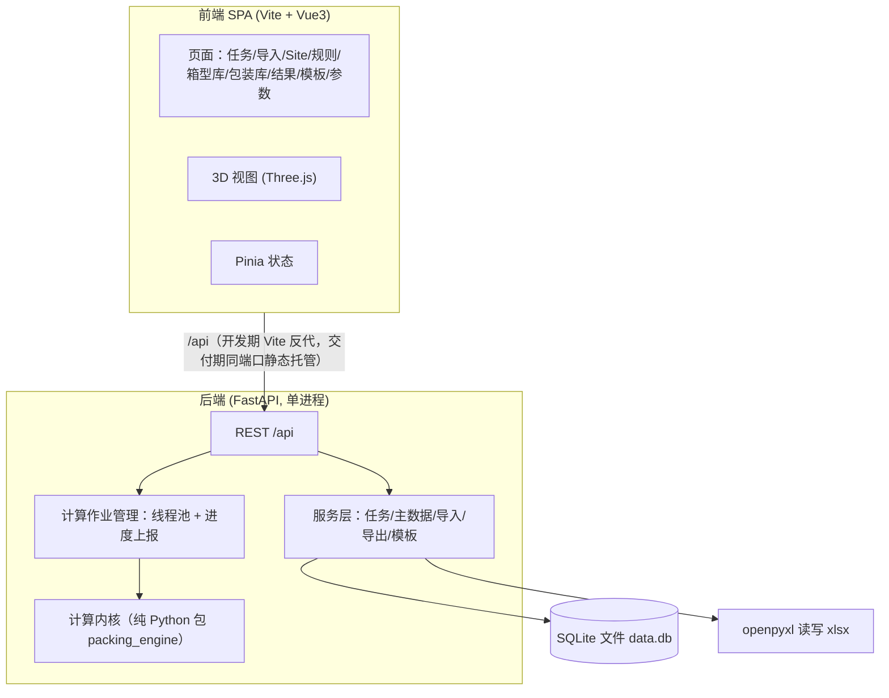

# 集装箱装箱工具 技术设计（design.md）

Feature Name: container-packing
Updated: 2026-10-28
对应需求：当前工作区 `.monkeycode/specs/container-packing/requirements.md`（R1–R33）
对应 PRD：当前工作区 `.monkeycode/specs/container-packing/PRD.md`（v1.1）

---

## 1. Description

Web 版集装箱装箱工具：FastAPI + SQLite 后端、Vue3 + Three.js 前端、PyInstaller 打包 Windows 单文件 exe。核心是规则引擎 + 摆放算法 + KPI 对账。本文给出模块划分、接口契约、数据表、算法伪代码、正确性性质与测试矩阵。

## 2. Architecture



- 交付形态：exe 启动 FastAPI，前端构建产物由同一端口静态托管；开发期 Vite dev server 将 `/api` 反代到 8000 端口，`server.allowedHosts: ['.monkeycode-ai.online']`
- 计算内核独立成包 `packing_engine`，不依赖 Web 框架，可单独单测
- 计算作业在后端线程池执行；前端轮询 `/api/jobs/{id}` 获取进度与 ETA（R31）

## 3. Components and Interfaces

### 3.1 REST API 契约

统一返回 `{code, message, data}`；错误码见 §7。

| 方法 & 路径 | 说明 | 对应需求 |
|-------------|------|----------|
| GET/POST /api/container-types，PUT/DELETE /api/container-types/{id} | 箱型库 CRUD；DELETE 校验引用 | R21 |
| POST /api/container-types/import；GET /api/container-types/export | 箱型 Excel 导入导出 | R21 |
| GET/POST /api/packages，PUT/DELETE /api/packages/{id} | 包装主数据 CRUD | R22 |
| POST /api/tasks；GET /api/tasks；GET/PUT/DELETE /api/tasks/{id} | 任务 CRUD | R7 |
| POST /api/tasks/{id}/import | 上传 xlsx，返回导入预览（含逐行错误、缺失/未匹配清单） | R1/R25 |
| POST /api/tasks/{id}/import/batch-maintain | 上传待填表，写入包装主数据 | R25 |
| POST /api/tasks/{id}/import/supplement | body: [{pn, name, l, w, h, tare, net, gross}]，JSON 批量 upsert 主数据后自动 re-match，返回最新 preview | R32 |
| POST /api/tasks/{id}/import/re-match | 重新按 PN→PackMatls 补全 | R25 |
| GET/PUT /api/tasks/{id}/site-groups | Site 分组确认（同柜/分离勾选） | R26 |
| POST /api/tasks/{id}/compute | body: {mode, container_spec, algorithms[], overrides} → {jobId} | R2/R16/R19/R33 |
| GET /api/jobs/{jobId} | {status, algorithms:[{name, progress, eta_seconds, done_ms, timed_out}], overall_eta} | R31 |
| GET /api/tasks/{id}/plans；PUT /api/tasks/{id}/adopted | 方案列表（含 KPI）、指定采用方案 | R15/R16 |
| GET /api/plans/{planId}/placements | 逐箱逐件摆放结果（前端 3D 数据源） | R6/R29 |
| GET /api/tasks/{id}/export?plan_id&template_id | 回写导出 xlsx | R4/R27/R28 |
| GET/POST/PUT/DELETE /api/export-templates | 导出模板 CRUD；默认模板禁删 | R5 |
| DELETE /api/tasks/{id}/runs | 清空当前任务全部 runs 的方案与采用态（重新计算前置） | R33 |
| GET/PUT /api/settings | 全局参数（人工上限/铲齿/时限/间隙） | R9/R18 |

### 3.2 计算内核 packing_engine 模块

```
packing_engine/
  model.py        # CargoItem, ContainerInstance, Placement, Plan, Param
  normalize.py    # 单位换算(cm→mm)、主数据补全后的行→CargoItem
  groups.py       # Site 同柜组、PN 连续分组与排序
  rules.py        # 规则校验器集合（见 §5.2）
  geometry.py     # AABB 相交、包围盒、支撑判定
  place.py        # DBLF / MaximalSpace / ExtremePoint / WallBuild / Guillotine
  freemix.py      # 自由组合搜索
  kpi.py          # 单箱与整体 KPI（公式唯一实现处）
  runner.py       # 算法调度、时限、进度回调
```

### 3.3 前端组件

| 组件 | 要点 |
|------|------|
| ImportPreview | 逐行状态、错误定位、缺失 PN 汇总、未匹配主数据勾选+批量编辑+一键写入（R32）、批量维护入口 |
| TaskDetail | 计算按钮按是否有历史方案在「开始计算/重新计算」间切换；重新计算前调 DELETE /runs 清空（R33） |
| SiteConfirm | 站点卡片列表、同柜/分离勾选、互斥校验提示 |
| KpiCompare | 多算法对照表、列排序、采用方案单选 |
| View3D | 箱列表/页签、选中居中、0.5–4× 回放、点选高亮（R29） |
| ExportDesigner | 字段拖选、列序、列宽、格式预览 |
| JobProgress | >3s 出现：各算法进度条 + ETA + 超时标记（R31） |

## 4. Data Models（SQLite）

```sql
container_type(id PK, code UNIQUE, name, iso_code, inner_l, inner_w, inner_h,
                door_w, door_h, max_payload, tare_weight, volume, enabled, remark)
package_master(id PK, pn UNIQUE NULL, code, name, package_type, cargo_type,
                l, w, h, tare, net, gross, volume, rotatable, same_type_stack,
                default_loading, max_stack, max_load, enabled, remark)
task(id PK, name, created_at, params_json, rules_json, site_groups_json,
     container_mode_json, status, adopted_plan_id, last_ok_plan_id)
import_row(id PK, task_id FK, row_no, a_no, b_len, c_wid, d_hgt, e_cbm,
           f_outcase, g_packmatls, h_tare, i_net, j_gross, k_pn, l_note,
           m_site, o_ref, p_dn, q_misc,
           filled_fields_json,      -- 记录 b..j 中哪些值来自主数据（R25）
           source_flag)             -- table | master | temporary
packing_run(id PK, task_id FK, created_at, status, algorithms_json)
packing_plan(id PK, run_id FK, algorithm, is_adopted, kpi_json, created_ms)
container_instance(id PK, plan_id FK, type_code, seq_no, label)  -- label=40GP-1
placement(id PK, plan_id FK, container_id FK, import_row_id FK,
          x, y, z, dim_x, dim_y, dim_z,          -- mm，含朝向后的最终尺寸
          rotation, load_seq, unassigned_reason)
export_template(id PK, name, is_default, columns_json)
app_setting(key PK, value)
```

- 全部尺寸入库即 mm（导入 cm ×10），重量 kg；单一单位制贯穿内核
- placement 未分配货物也落行：container_id 为空 + unassigned_reason，保证逐件对账（R30）

## 5. 算法设计

### 5.1 主流程（runner）

```python
def compute(task, algorithms, deadline_s):
    items = normalize(load_rows(task))          # 已补全，含来源标记
    check_preconditions(items, task)            # R25 拦截、Site 组预检
    groups = build_groups(items, task.site_groups)   # 同柜组(不可拆) / PN 链
    for algo in algorithms:                     # 并行线程，各自 deadline
        with ProgressReporter(algo) as pr:      # 进度+ETA 回调 (R31)
            plan = algo.run(items, groups, task.container_spec, pr)
            plan.kpi = kpi.evaluate(plan)       # 单箱 + 整体
    return plans
```

### 5.2 规则校验器（rules.py，每个校验器输入 plan 状态与候选摆放，输出 通过/原因）

| 校验器 | 逻辑 |
|--------|------|
| bounds | 0 ≤ 坐标，且坐标+尺寸 ≤ 箱内尺寸（mm） |
| collision | 与同箱已放件 AABB 两两相交检测（网格加速可后置） |
| payload | Σ毛重 + 本件 ≤ max_payload |
| weight_order | 直接支撑面上所有下件单件毛重 ≥ 本件（R10） |
| crush | 支撑件 max_load=0 时禁止顶部堆压；max_load>0 时按承压上限校验被压件重量（R11） |
| same_type_stack | 本件或正下件标记 same_type_stack 时，货物类型必须相同（R12） |
| fork_tine | loading=叉车：进叉轴边长 ≤ 铲齿长度（R18）；进叉轴默认箱长方向 |
| manual_limit | 重量 > 上限（默认 30kg）强制叉车（R9） |
| pn_continuous | 同箱内同 PN 沿箱长连续：本件 x 区间与同 PN 已放件的并集相交或相邻（R8） |
| inside_out | 本件内端面 x ≤ 同箱所有 load_seq 较小件的内端面 x（R17，x 轴=门→箱内） |

降级机制：校验失败且该规则优先级低于已启用互斥规则时，记录 `degraded_rules` 并放行仅限 R14 允许的情形；其余失败→本件当前候选点不可用。

### 5.3 DBLF（默认算法）

```python
def dblf(items, container, ctx):
    candidates = [(0,0,0)]
    order = sort_by_pn_chain_then_weight_desc(items)   # PN 链内按重→轻
    for it in order:
        for orient in allowed_orientations(it):        # 水平 90°（R25 旋转属性）
            best = pick_deepest_fitting(candidates, orient, ctx.checkers)
            if best: place(it, best); add_candidate_points(best); break
        else:
            mark_unassigned(it, reason_of_first_violation)
    # candidates 有序：y(宽)→x(深)→z(高)；由内向外=沿 x 递增填充（x=门→内）
```

### 5.4 MaximalSpace（默认算法）

维护空腔矩形列表：放置后用候选件切割被占空间生成新空腔；评分 = 体积利用率增量 + 空腔规整度。其余三算法（ExtremePoint / WallBuild / Guillotine）按标准实现，均复用同一 checkers 链。

### 5.5 自由组合搜索（freemix）

```python
def search(items, catalog, locks, deadline):
    lb_containers = max(ceil(Σvol/max_inner_vol), ceil(Σgross/max_payload))
    for combo in bounded_combinations(catalog, locks, lb, upper=lb+3):  # 剪枝
        plan = run_dblf(items, combo)        # 复用默认算法评估
        yield plan
    return lexicographic_best(plans, key=[完成率↓, 用箱数↑, 平均体积利用率↓])
```

组合上界：候选箱型 ≤5、总箱数 ≤20（PRD §10.4 基准线内保证出解）。

### 5.6 KPI（kpi.py 唯一实现，R30 公式）

```python
per_container: vol_util = Σvol/container.inner_vol; pay_util = Σgross/max_payload
               load_seq_correct_ratio; constraint_ok_ratio; cg_offset_mm
overall: vol_util = ΣΣvol / Σinner_vol; pay_util = ΣΣgross / Σmax_payload
         completion = assigned/total; unassigned_* = Σ; weighted ratios; max(elapsed)
invariant: overall 必须可由 per_container 复算（P3，单测对账）
```

### 5.7 导出回写（R27）

N 列 = container_instance.label；新增「装箱顺序」列 = load_seq（每柜 1..n，按内端面 x 升序）；A–P/Q 原值透传（N 覆盖）；未分配行两列留空。全部走 openpyxl，输出 xlsx；CSV 兜底用 `utf-8-sig`（R28）。中文文件名经 `Content-Disposition: attachment; filename*=UTF-8''...`（RFC 5987）。

## 6. Correctness Properties

| # | 性质 | 验证 |
|---|------|------|
| P1 | 任意两件 placement AABB 不相交且全部在箱内 | 随机方案性质测试 |
| P2 | 已分配件满足全部启用规则，或降级记录在案 | 逐件断言 |
| P3 | 整体 KPI = 由单箱 KPI 按固定公式复算 | KPI 对账单测（场景 16） |
| P4 | load_seq 与内端面 x 严格同序，每柜从 1 连续 | 排序断言 |
| P5 | 每条 import_row 尺寸齐全后才可进入计算 | 导入门禁 |
| P6 | Site 必须同柜组完整落在同一 container_instance | 分组断言 |
| P7 | 同 PN 的 container 序号连续，箱内沿箱长连续 | 方案遍历断言 |
| P8 | 叉车件进叉轴边长 ≤ 铲齿长度 | 逐件断言 |
| P9 | 直接上下堆叠时下件毛重 ≥ 上件 | 逐件断言 |
| P10 | 回写后文件除 N 与新增列外与原表逐格一致 | 往返 diff 测试 |

## 7. Error Handling

| 场景 | 行为 | 码 |
|------|------|----|
| 导入行缺规格且 PN/PackMatls 不命中 | 预览标红 + 缺失/未匹配清单，compute 拒绝 | E_IMPORT_INCOMPLETE / E_NO_MASTER_MATCH |
| supplement 批量写入时任一关键规格（长/宽/高）为空或非正 | 拒绝整批写入，前端逐字段标红 | E_VALIDATION |
| 文件编码异常 | 按 UTF-8/BOM/GBK 依次探测，全失败则报「无法识别编码」 | E_ENCODING |
| 计算超时 | 单算法返回部分方案 + timed_out 标记（R31） | W_TIMEOUT |
| 自由组合锁定无解 | 终止并返回「锁定条件无可行解」 | E_NO_FEASIBLE |
| 端口占用 | 启动器探测换空闲端口，打开实际地址 | - |
| 删除被引用箱型/默认模板 | 409 + 提示改停用 | E_IN_USE |
| 计算线程异常 | job 置 failed，任务保留上次成功方案（R7） | E_ENGINE |

## 8. Test Strategy（用例矩阵）

| 需求 | 单元 | 集成/E2E |
|------|------|----------|
| R1/R25 导入补全 | 列映射、cm→mm、编码探测（UTF-8/BOM/GBK/坏文件） | 场景 1/2/14 |
| R7 任务 | 任务持久化 round-trip | 重开任务数据一致 |
| R8 PN 连续 | pn_continuous 校验器、链排序 | 场景 5 |
| R9/R18 | manual_limit、fork_tine 边界（=1220、1221） | 场景 7 |
| R10–R12 | weight_order/crush/same_type 真值表（crush 按 max_load=0 判定） | 场景 6 |
| R13/R26 | Site 分组构建、互斥校验 | 场景 3/4 |
| R14 | 优先级排序与降级记录 | 场景 6 |
| R15/R30 | kpi 公式逐项 + P3 复算对账 | 场景 16 |
| R16 | 5 算法收敛于金样本（已知最优小算例）、超时返回部分解 | 场景 10 |
| R17 | inside_out 同序断言（P4） | 场景 1 回放步骤 |
| R19 | 下界估计、枚举剪枝、锁定无解 | 场景 8/9 |
| R21/R22 | 主数据 CRUD 校验、引用禁删 | 界面操作 |
| R23 | （视觉走查清单，不入自动测试） | M5 走查 |
| R24 | 端口探测、数据目录持久化 | 场景 13 |
| R27/R28 | 回写 diff（P10）、utf-8-sig、RFC5987 文件名 | 场景 1/14 |
| R29 | （前端 E2E：每箱渲染、居中、倍速） | 场景 15 |
| R31 | ProgressReporter eta 单调性 | 场景 17 |
| R32 | supplement 批量 upsert + 自动 re-match、重复 PN 更新而非新建、未填规格拦截 | 场景 18 |
| R33 | 重新计算前清空 runs 保留配置、无方案时不清空 | 场景 19 |
| P1/P9 等 | 随机方案性质测试（hypothesis 风格） | 每次回归 |

回归基线：业务样表 Step3Output-1.xlsx；金样本 = 手工验算过最优解的小算例（≤10 件）。

## 9. References

[^1]: (Filename) - 当前工作区 `.monkeycode/specs/container-packing/requirements.md`
[^2]: (Filename) - 当前工作区 `.monkeycode/specs/container-packing/PRD.md`
[^3]: (Filename) - 当前工作区 `.monkeycode-tmp-files/d340e47a-Step3Output-1.xlsx`（回归基线样表）
